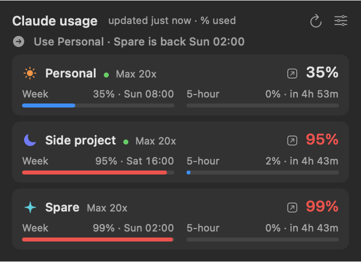

# Claude Usage Bar

A macOS menu-bar app that shows how much of your Claude plan you've used: the weekly limit and the 5-hour limit, with reset times. It works for one Claude login or several side by side, and tells you which account to use when one runs low.



Not made by or affiliated with Anthropic.

## What you need

- macOS 14 or later
- [Claude Code](https://claude.com/claude-code) installed and logged in to a Pro or Max plan (run `claude` once and `/login` if you haven't)

## Install

```bash
git clone <this repo>
cd claude-usage-bar
xcode-select --install   # once, if you don't have Xcode's command line tools
./build.sh
```

That builds the app (Apple Silicon and Intel), copies it to `/Applications` and starts it. Look for the numbers in your menu bar. Building it yourself means macOS doesn't block it as an app from an unidentified developer.

## More than one account

With no config file it shows your normal `claude` login. For several accounts, give each its own Claude Code config folder and log in to each one once:

```bash
CLAUDE_CONFIG_DIR=~/.claude-side claude   # then /login with the other account
```

Then create `~/.config/claude-usage-bar/accounts.json` (see `accounts.example.json`):

```json
{
  "accounts": [
    { "name": "Personal", "subtitle": "Max", "glyph": "☀︎", "symbol": "sun.max.fill", "tint": "orange" },
    { "name": "Side project", "subtitle": "Max", "glyph": "☾", "symbol": "moon.fill", "tint": "indigo",
      "config_dir": "~/.claude-side" },
    { "name": "Work", "subtitle": "Team seat", "glyph": "①", "symbol": "briefcase.fill", "tint": "blue",
      "token_file": "~/.config/claude-tokens/work.token", "group": "work", "desktop_app": false }
  ]
}
```

| Field | Meaning |
|---|---|
| `name` | Required. Shown on the card and in Settings. |
| `config_dir` | The account's `CLAUDE_CONFIG_DIR`. Leave out both this and `token_file` for your default `~/.claude` login. |
| `token_file` | Instead of a config folder: a file holding a token from `claude setup-token`. |
| `group` | The "Use X" hint only suggests an account in the same group, so it won't send personal work to a work seat. |
| `desktop_app` | `false` hides the Open button, for a login you only use in the terminal. |
| `subtitle` | Small text beside the name, e.g. the plan and what the account is for. |
| `glyph` | The mark in the menu bar (any character). |
| `symbol` | An [SF Symbol](https://developer.apple.com/sf-symbols/) name for the card. |
| `tint` | red, orange, yellow, green, mint, teal, cyan, blue, indigo, purple, pink, brown or gray. |
| `desktop_profile` | Optional. If you run a second Claude desktop app with `--user-data-dir`, put that folder here and the Open button will open that one. |
| `desktop_launcher` | Optional. An app that starts this account's desktop app, such as a per-account launcher in `/Applications`. If set, the Open button opens it instead of starting Claude with `desktop_profile`. |
| `usage_file` | Optional. A file another tool keeps this account's reading in, in Claude Code's statusLine-cache shape: `seven_day_pct`, `seven_day_resets_at`, `five_hour_pct`, `five_hour_resets_at` (ISO time or epoch seconds) and `at_epoch` (when it was read). The app shows whichever is newer, the file or its own check, so a fresh file saves a check. A file without `at_epoch` is ignored. |
| `role_id` | Optional. This account's id in the roles file (below). |

### Role labels from a file

If something else already decides what each account is for, the card can show that instead of a fixed subtitle. Add a `roles` block naming a YAML-style file, the top-level section to read, and the label for each key. The app reads lines like `key: id id …` in that section; an account whose `role_id` is in a key's list gets that key's label. A list of labels gives one label per position in the key's list. Labels follow `subtitle`, joined with " · ", and are re-read each time you open the panel.

```json
{
  "roles": { "file": "~/work/roles.yaml", "section": "accounts",
             "labels": { "primary": "main", "spare": ["first spare", "last resort"] } },
  "accounts": [ { "name": "Side project", "config_dir": "~/.claude-side", "role_id": "s" } ]
}
```

Quit and reopen the app after editing the file.

## Reading the panel

Each card leads with the same number the menu bar shows for it, with the age of that account's reading underneath. Each limit has a bar of how much is used and a tick at how far through that window the clock is: fill past the tick means the account is being used faster than an even pace, and the line under it says by how many points. Colour only means something: orange when more than 5 points over pace, red when 10% or less is left. Reset times are always shown as weekday and time.

The "Use X" line appears when an account is nearly out (under 10% left) and another account in the same `group` isn't. Give an account its own `group` to keep it out of those suggestions.

In the menu bar with Mark set to None, numbers in the same `group` are separated by a dot and groups by a bar.

## How it gets the numbers

A check runs one tiny Claude Code turn for an account (`claude -p hi --model haiku`) and reads the rate-limit figures Claude Code prints with it. They're the same numbers `/usage` and the statusLine show. While the panel is open, any account whose newest reading is more than 2 minutes old is checked (looked at every 30 seconds); while it is closed, an account is checked once its newest reading passes 15 minutes. A failed check is retried after 10 minutes. ↻ checks every account now. Each check uses a tiny amount of that plan's usage; a `usage_file` that is fresher than these limits means no check at all.

It never reads, copies or refreshes your cookies or keychain, and never touches the network itself. Claude Code uses its own login for that account. If you give an account a `token_file`, the app reads that file and passes the token to that one Claude Code run, nothing else. The turn runs in an empty temporary folder and leaves out your user settings and MCP servers, so your own hooks and tools don't run with it.

## Settings

Click the sliders icon in the panel to choose: used or left, which accounts appear in the menu bar, which limit the menu-bar number shows, the 5-hour row, reset times, a notification when a nearly-used-up limit resets, and open at login. Which accounts appear in the menu bar is remembered by account name, so adding or reordering accounts keeps each setting with its account.

## Checking it

`ClaudeUsageBar --selftest` checks the roles-file and usage-file parsing and the pace maths on fixed inputs and exits 1 if any case fails. `ClaudeUsageBar --snapshot <dir>` takes live readings and renders the panel and settings, dark and light, to PNGs.
