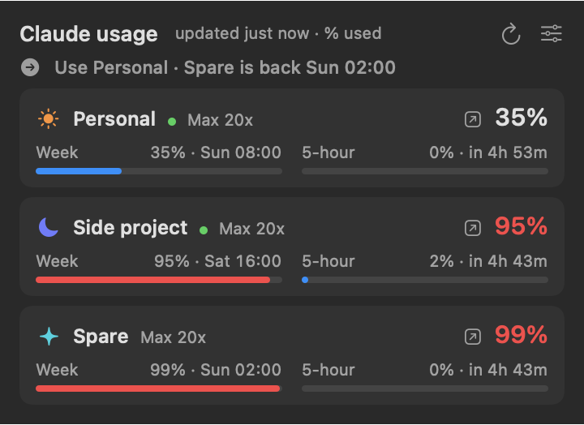

# Claude Usage Bar

A macOS menu-bar app that shows how much of your Claude plan you've used: the weekly limit and the 5-hour limit, with reset times. It works for one Claude login or several side by side, and tells you which account to use when one runs low.



Not made by or affiliated with Anthropic.

## What you need

- macOS 14 or later
- [Claude Code](https://claude.com/claude-code) installed and logged in to a Pro or Max plan (run `claude` once and `/login` if you haven't)

## Install

```bash
git clone <this repo>
cd claude-usage-bar
xcode-select --install   # once, if you don't have Xcode's command line tools
./build.sh
```

That builds the app (Apple Silicon and Intel), copies it to `/Applications` and starts it. Look for the numbers in your menu bar. Building it yourself means macOS doesn't block it as an app from an unidentified developer.

## More than one account

With no config file it shows your normal `claude` login. For several accounts, give each its own Claude Code config folder and log in to each one once:

```bash
CLAUDE_CONFIG_DIR=~/.claude-side claude   # then /login with the other account
```

Then create `~/.config/claude-usage-bar/accounts.json` (see `accounts.example.json`):

```json
{
  "accounts": [
    { "name": "Personal", "subtitle": "Max", "glyph": "☀︎", "symbol": "sun.max.fill", "tint": "orange" },
    { "name": "Side project", "subtitle": "Max", "glyph": "☾", "symbol": "moon.fill", "tint": "indigo",
      "config_dir": "~/.claude-side" },
    { "name": "Work", "subtitle": "Team seat", "glyph": "①", "symbol": "briefcase.fill", "tint": "blue",
      "token_file": "~/.config/claude-tokens/work.token", "group": "work", "desktop_app": false }
  ]
}
```

| Field | Meaning |
|---|---|
| `name` | Required. Shown on the card and in Settings. |
| `config_dir` | The account's `CLAUDE_CONFIG_DIR`. Leave out both this and `token_file` for your default `~/.claude` login. |
| `token_file` | Instead of a config folder: a file holding a token from `claude setup-token`. |
| `group` | The "Use X" hint only suggests an account in the same group, so it won't send personal work to a work seat. |
| `desktop_app` | `false` hides the Open button, for a login you only use in the terminal. |
| `subtitle` | Small text beside the name, e.g. the plan and what the account is for. |
| `glyph` | The mark in the menu bar (any character). |
| `symbol` | An [SF Symbol](https://developer.apple.com/sf-symbols/) name for the card. |
| `tint` | red, orange, yellow, green, mint, teal, cyan, blue, indigo, purple, pink, brown or gray. |
| `desktop_profile` | Optional. If you run a second Claude desktop app with `--user-data-dir`, put that folder here and the Open button will open that one. |

Quit and reopen the app after editing the file.

## How it gets the numbers

Each refresh runs one tiny Claude Code turn per account (`claude -p hi --model haiku`) and reads the rate-limit figures Claude Code prints with it. They're the same numbers `/usage` shows. It refreshes when it starts, every 30 minutes, when you open the panel after 10 minutes, and when you press ↻. Each refresh uses a tiny amount of your plan's usage.

It never reads, copies or refreshes your cookies or keychain, and never touches the network itself. Claude Code uses its own login for that account. If you give an account a `token_file`, the app reads that file and passes the token to that one Claude Code run, nothing else. The turn runs in an empty temporary folder and leaves out your user settings and MCP servers, so your own hooks and tools don't run with it.

## Settings

Click the sliders icon in the panel to choose: used or left, which accounts appear in the menu bar, which limit the menu-bar number shows, the 5-hour row, reset times, a notification when a nearly-used-up limit resets, and open at login.
